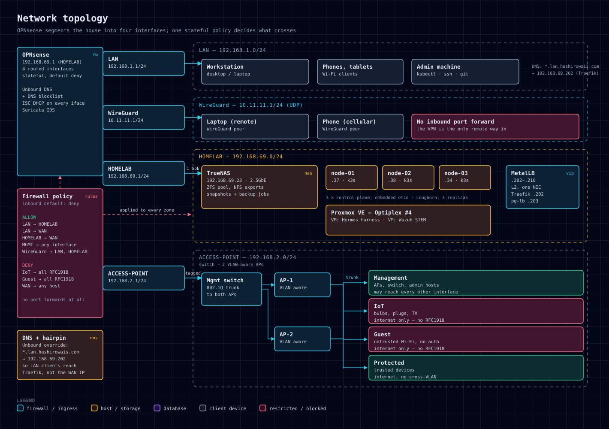
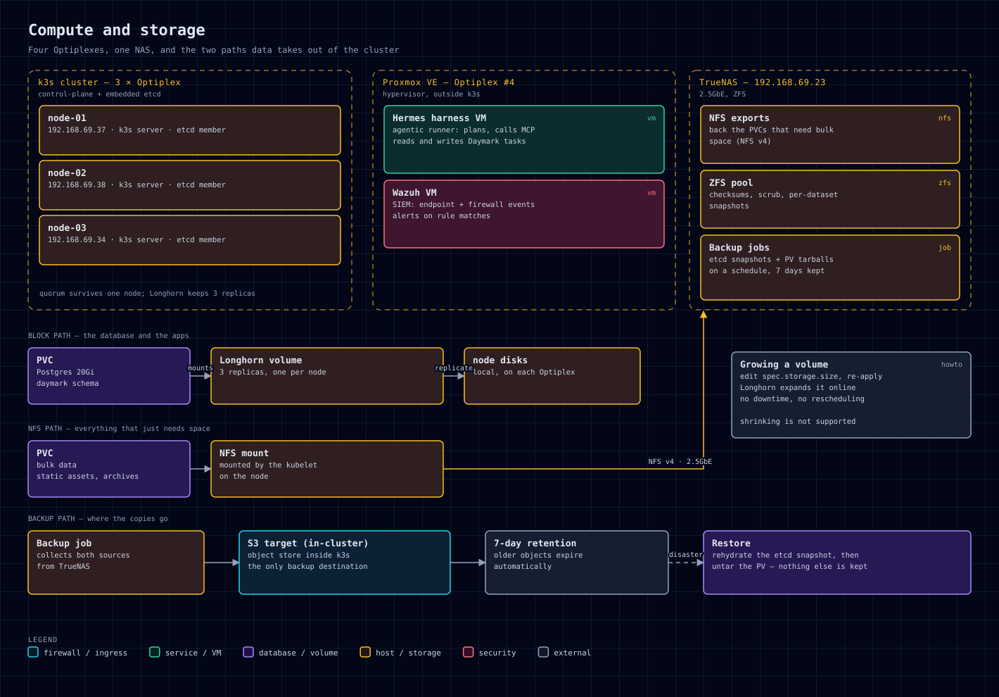
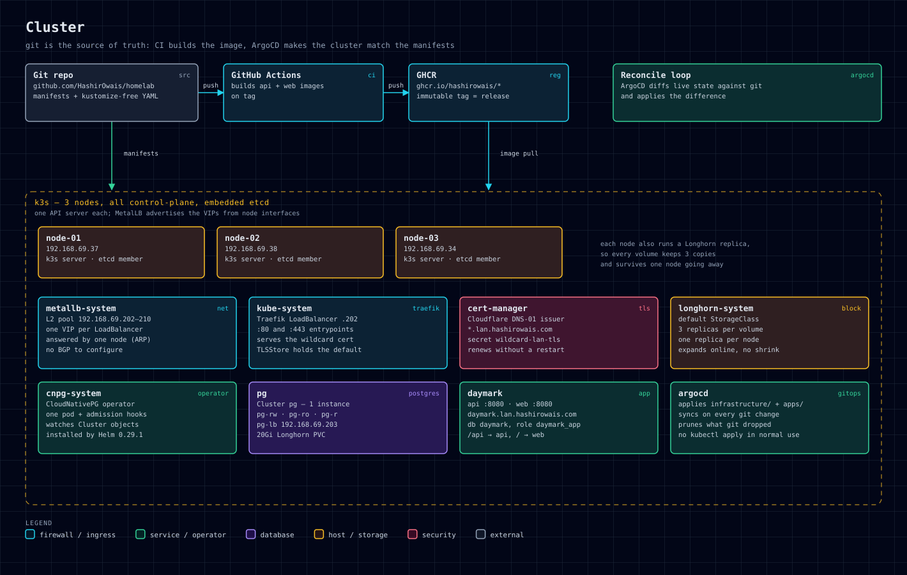
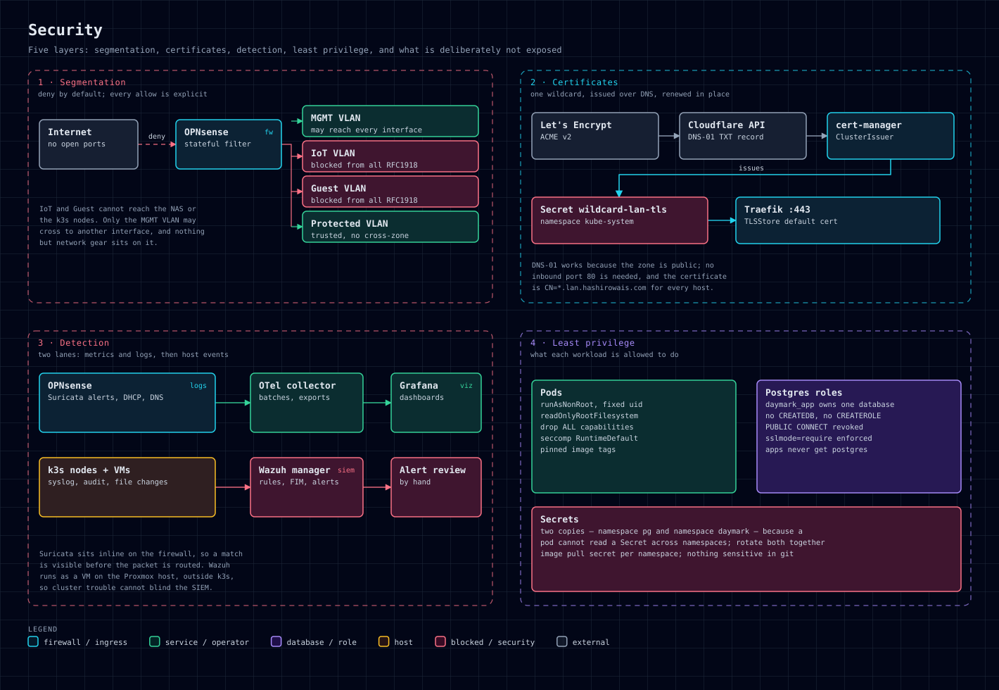
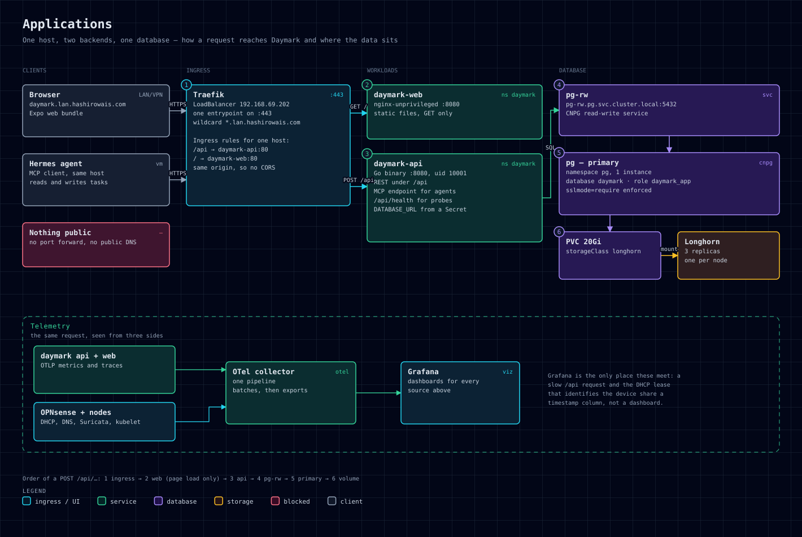

# Homelab

Four Dell Optiplexes and a NAS: three of the Optiplexes run a k3s cluster with
every node as control-plane, the fourth runs Proxmox for the things that should
not live inside Kubernetes, and the NAS provides storage and backups. One
OPNsense firewall separates the house from the lab, and one GitHub repo
describes everything that runs.

Everything here is LAN-only. There are no inbound port forwards, no public
services, and no cloud dependency beyond a Cloudflare DNS zone used to prove
domain ownership for TLS certificates.

## What's here

| Path | What it covers |
|---|---|
| [docs/network.md](docs/network.md) | The four OPNsense interfaces, the VLANs behind the access points, DHCP, DNS, WireGuard, and the firewall rules |
| [docs/security.md](docs/security.md) | Why the network is segmented the way it is, the IDS, the SIEM, how certificates are issued, and how workloads are locked down |
| [docs/compute.md](docs/compute.md) | The cluster nodes, the Proxmox host and its two VMs, TrueNAS storage, and the backup scheme |
| [docs/apps.md](docs/apps.md) | Daymark, the shared Postgres cluster, the Hermes harness, and observability |
| [diagrams/](diagrams/) | Five hand-written SVGs of the same material, one per layer |

## The short version

- **Network** — OPNsense routes LAN (192.168.1.0/24), HOMELAB (192.168.69.0/24),
  ACCESS-POINT (192.168.2.0/24) and WireGuard (10.11.11.0/24). The wireless side
  is split into four VLANs; only the Management VLAN may reach the other
  interfaces.
- **Compute** — `node-01` (.37), `node-02` (.38), `node-03` (.34) are k3s
  servers with embedded etcd. The fourth Optiplex runs Proxmox with a Hermes VM
  and a Wazuh VM.
- **Storage** — TrueNAS (.23) exports NFS and holds the backups; Longhorn keeps
  three replicas of every block volume.
- **Apps** — Daymark (a task journal) on the shared CloudNativePG cluster,
  behind Traefik at `daymark.lan.hashirowais.com`.

## Diagrams

### Network topology

Each interface on the firewall is its own broadcast domain and its own DHCP
scope, with the firewall as the only router between them. The HOMELAB interface
carries the NAS and the three cluster nodes; the LAN carries people's machines;
the ACCESS-POINT interface carries one management switch and two VLAN-aware
access points, which fan out into four VLANs — Management, IoT, Guest and
Protected. Traffic between any two of those zones has to be routed by OPNsense,
which is the point: the rules live in one place instead of in a switch's config.
Guest and IoT are allowed to the internet and blocked from every private range,
so a compromised bulb cannot reach the NAS.

### Compute and storage

Data leaves the cluster on two paths. Block volumes are Longhorn's — three
replicas, one on each node, so losing a node leaves two copies and the volume
reattaches. Anything that only needs space goes over NFS to TrueNAS on its
2.5GbE link. Backups are separate from both: a job on TrueNAS collects etcd
snapshots and tarred volumes and pushes them to an S3 target running in the
cluster, keeping seven days.

### Cluster

Git is the source of truth. A tag in the app repo makes GitHub Actions build and
push images to GHCR; the tag is then written into the manifests here, and ArgoCD
applies the difference between git and the live cluster. Nothing in the cluster
is changed by hand as part of a normal release. Inside, MetalLB hands out VIPs
from a small L2 pool, Traefik terminates TLS for the one wildcard, cert-manager
keeps that certificate current, Longhorn provides the default StorageClass, and
CloudNativePG runs the shared Postgres.

### Security

The design assumes the network is hostile in both directions: an IoT device may
be compromised, and a guest's laptop may be. Segmentation keeps those failures
local. Certificates come from Let's Encrypt over a DNS-01 challenge, so no
inbound port has to be open to renew them. Detection is deliberately split —
Suricata sits inline on the firewall, Wazuh runs on the Proxmox host outside
Kubernetes, so a cluster problem cannot take the SIEM down with it.

### Applications

A request hits Traefik on 192.168.69.202, which routes one host two ways: `/api`
to the Go API and everything else to the static web bundle. Same origin, so
there is no CORS configuration anywhere. The API talks to `pg-rw`, the
CloudNativePG read-write service, which always points at the primary; the
primary's volume is a Longhorn PVC with three replicas. The Hermes agent uses
the same host and the same API, over the MCP endpoint, so an agent reads and
writes tasks through exactly the path a browser does.

## Reading order

If you want the tour: [docs/network.md](docs/network.md) explains the plumbing,
[docs/compute.md](docs/compute.md) the machines, [docs/security.md](docs/security.md)
the reasoning behind both, and [docs/apps.md](docs/apps.md) what actually runs.
