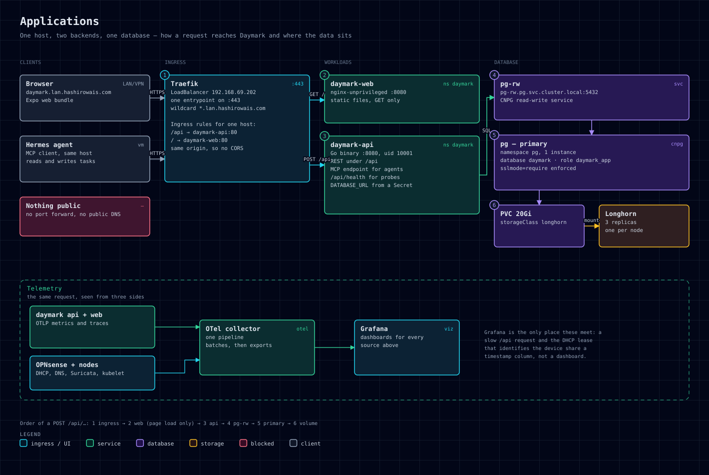

# Applications

Two things run here on purpose: Daymark, and the Postgres cluster it shares.
Everything else is infrastructure that exists so those two can work. The
observability stack and the optional services at the end are conveniences, not
dependencies.



## Daymark

A task journal: tasks with dates, notes and state. Two workloads behind one
hostname, plus a database.

| Piece | What it is | Where |
|---|---|---|
| `daymark-api` | Go binary, :8080, REST under `/api` | Deployment, namespace `daymark`, 1 replica |
| `daymark-web` | Expo / React Native web export served by nginx-unprivileged, :8080 | Deployment, namespace `daymark`, 1 replica |
| `daymark-api` service | ClusterIP :80 → 8080 | namespace `daymark` |
| `daymark-web` service | ClusterIP :80 → 8080 | namespace `daymark` |
| Ingress `daymark` | One host, two paths | `daymark.lan.hashirowais.com` |
| `daymark` database | Owned by role `daymark_app` | namespace `pg`, cluster `pg` |

### The request path

The numbered hops match the diagram:

1. **Client → Traefik.** `https://daymark.lan.hashirowais.com` resolves through
   Unbound to 192.168.69.202, the Traefik LoadBalancer. TLS is the wildcard
   certificate from the `TLSStore`; the Ingress has a `tls:` block with no
   `secretName`, which is how Traefik is told to use the default.
2. **`/` → `daymark-web`.** Anything not under `/api` is served by the static
   bundle. A page load stops here.
3. **`/api` → `daymark-api`.** Path prefix `/api` goes to the API service on
   port 80, which targets the container's 8080.
4. **API → `pg-rw`.** `DATABASE_URL` points at
   `pg-rw.pg.svc.cluster.local:5432`, CloudNativePG's read-write service, which
   always selects the primary. `sslmode=require` is in the URL and enforced by
   the cluster.
5. **Primary → volume.** The Postgres pod's 20Gi PVC on the `longhorn`
   StorageClass.
6. **Volume → replicas.** Longhorn keeps three copies, one per node.

One host, two backends, means the browser and the API share an origin. There is
no CORS configuration anywhere in the stack, because there is nothing
cross-origin. In the app's Settings the server URL is the bare host
(`https://daymark.lan.hashirowais.com`), no `/api` suffix — the client appends
the path itself.

### Agents

The API also speaks MCP, so an agent can list, create and update tasks the same
way the UI does. Agent delegation is supported: a task can be handed to an agent,
which works it through the same API. The Hermes harness is the main client; from
its point of view Daymark is just an HTTP service on the LAN with a tool
interface.

This is a deliberate design choice rather than a feature bolted on: there is one
write path, one set of permissions (`daymark_app`) and one audit trail. An agent
that misbehaves can corrupt the tasks it was given, but it cannot reach another
database or another namespace.

### Releasing

Images are built by GitHub Actions in the Daymark repo and pushed to GHCR as
`ghcr.io/hashirowais/daymark-api` and `-web`. Both Deployments pin an explicit
tag and pull through the `ghcr-pull` secret. A release is: tag upstream, wait for
the build, edit the two `image:` lines here, commit. The pinned tag is what the
cluster runs — that is why `:latest` is not used.

## Postgres

One CloudNativePG cluster, `pg`, in namespace `pg`, with a single instance.

| Object | Name | Notes |
|---|---|---|
| Operator | `cnpg` Helm release | namespace `cnpg-system`, watches `Cluster` objects |
| Cluster | `pg` | 1 instance, 20Gi on `longhorn` |
| Services | `pg-rw`, `pg-ro`, `pg-r` | ClusterIP; `pg-rw` always the primary |
| Service | `pg-lb` | LoadBalancer on MetalLB, pinned to 192.168.69.203 |
| Secret | `pg-superuser` | the `postgres` account; admin use only |
| Database | `app` | scratch database from `initdb` |
| Database | `daymark` | owned by `daymark_app`, created by Daymark's manifests |

`pg-lb` exists because the three default services cannot be retyped to
LoadBalancer. It selects the primary, so it is the LAN equivalent of `pg-rw`:

```
postgresql://daymark_app:…@pg-rw.pg.svc.cluster.local:5432/daymark   # in-cluster
postgresql://postgres:…@192.168.69.203:5432/daymark                  # from a laptop
```

### One database per app, defined next to the app

Daymark's database objects live in `apps/daymark/database.yaml`, not in the
Postgres folder. A folder then contains everything that app needs, and deleting
the app deletes its database definition with it. The objects have to be in
namespace `pg` — CloudNativePG only resolves `spec.cluster` inside its own
namespace — and they use `databaseReclaimPolicy: retain`, so deleting the YAML
never drops the data.

The credentials exist twice, and that is not an oversight:

- In namespace `pg` for `DatabaseRole` to read.
- In namespace `daymark` because a pod cannot read a Secret across namespaces.

Rotating the password means editing both copies and restarting the API. It is
the sharpest edge in this setup.

### What breaks, and how

- **Deleting the `Cluster` destroys the data.** PVCs go with it. Treat
  `kubectl delete cluster pg -n pg` like `DROP DATABASE`.
- **One instance means no failover.** If the node dies the pod reschedules in
  roughly 30–60 seconds and Longhorn reattaches the volume from a surviving
  replica. That is recovery, not high availability: there is a gap.
- **No WAL archiving.** The volume tarball is the recovery point. See
  [compute.md](compute.md#backups).
- **No resource requests or limits** on the cluster. Fine while nothing else
  competes; the first thing to add if the cluster gets crowded.

## Hermes

An agentic harness on a Proxmox VM: it plans, calls tools, and can drive other
services over MCP. It is not part of Kubernetes and does not need the cluster to
be healthy to start. Its main integration here is Daymark — reading tasks,
proposing changes, and taking delegated work — over the same hostname and API
that a browser uses.

Because it lives on the HOMELAB interface, it reaches Daymark the same way
anything else does, and it is subject to the same rule (`HOMELAB → LAN` is not
needed; both are on HOMELAB, so the traffic never leaves the subnet).

## Observability

Grafana with OpenTelemetry in front of it. The point is to be able to answer
"which device, which request, when" in one place:

| Source | What it contributes | Path |
|---|---|---|
| Daymark api + web | Metrics and traces per request | OTLP → collector → Grafana |
| k3s nodes and pods | Cluster telemetry | OTLP → collector → Grafana |
| OPNsense | DHCP leases, DNS queries, Suricata alerts | logs → Grafana |

The DHCP lease data is what makes the rest usable: an alert or a slow request
carries an IP address, and the lease table turns that into a device name. That
join is why the firewall's logs are worth shipping at all.

Wazuh is the other half of the picture and runs separately — see
[security.md](security.md#detection-wazuh). Grafana is for "what is the system
doing"; Wazuh is for "what changed on this machine".


