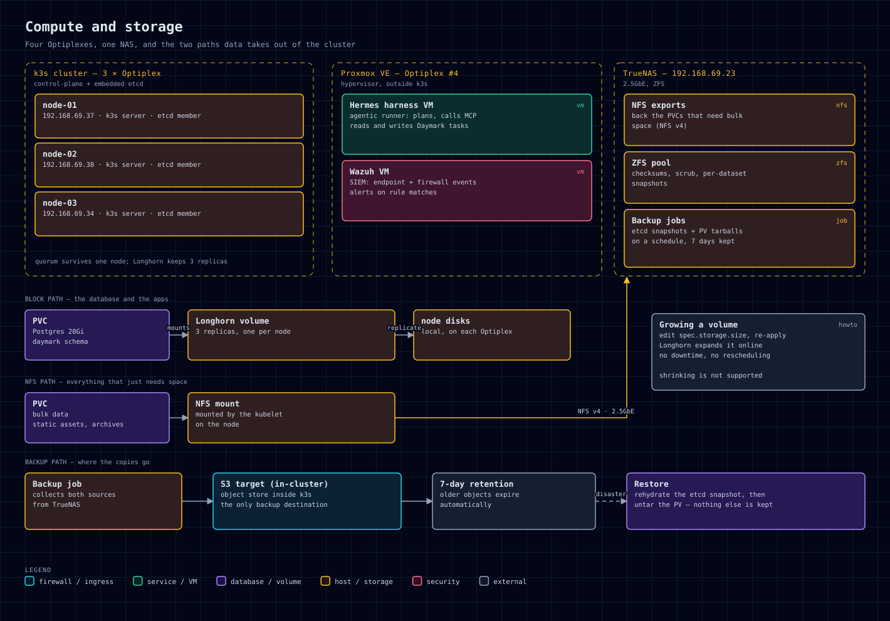

# Compute and storage

Four identical Optiplex machines do the work. Three are the Kubernetes cluster;
the fourth is a hypervisor. A separate TrueNAS box holds the data the cluster
cannot hold itself.

| Machine | Address | Role | Runs |
|---|---|---|---|
| node-01 | 192.168.69.37 | k3s server, control-plane, embedded etcd | Workloads, Longhorn replica |
| node-02 | 192.168.69.38 | k3s server, control-plane, embedded etcd | Workloads, Longhorn replica |
| node-03 | 192.168.69.34 | k3s server, control-plane, embedded etcd | Workloads, Longhorn replica |
| Optiplex #4 | on HOMELAB | Proxmox VE | Hermes VM, Wazuh VM, Fedora Docker host |
| TrueNAS | 192.168.69.23 | NAS | ZFS pool, NFS exports, backup jobs |

## The cluster nodes

All three nodes are `k3s server` with the embedded etcd datastore. There is no
separate control plane: every node runs an API server, a scheduler and an etcd
member, and workloads run on all three. Quorum is two of three, so the cluster
survives losing one node and stops accepting writes at two.

Building it is deliberately boring. `bootstrap/` holds host-level scripts that
disable swap, install k3s with **Traefik, ServiceLB, metrics-server and
local-path disabled**, and fetch a kubeconfig. The bundled Traefik is disabled
because the cluster runs its own Traefik release; ServiceLB and local-path are
disabled because MetalLB and Longhorn do those jobs here. Everything above k3s
is declarative and lives in `infrastructure/` and `apps/`.

Two consequences of the "all nodes are equal" choice:

- **There is no node to lose gracefully.** Losing one costs a third of the CPU
  and memory and triggers every pod to reschedule, but not an outage.
- **Longhorn's replica count matches the node count exactly.** Three replicas,
  one per node, so a single failure leaves two copies and the volume can still
  be written. A fourth replica would not have anywhere to go.

## The Proxmox host

The fourth Optiplex runs Proxmox and two VMs that are deliberately outside
Kubernetes:

| VM | What it does | Why not in k3s |
|---|---|---|
| Hermes | Agentic harness: plans work, calls MCP tools, reads and writes Daymark tasks | Needs a long-lived, stateful home with a shell; restarts with the cluster would be noise |
| Wazuh | SIEM: collects host and firewall events, applies rules, raises alerts | A SIEM inside the system it watches goes down with the system |

That is the whole reason the fourth machine exists. Anything that has to
survive the cluster being rebuilt belongs on Proxmox, and anything that has to
be reachable while the cluster is broken belongs there too. Proxmox also gives
the VMs snapshots and a console that does not depend on the cluster being
healthy.

## TrueNAS

TrueNAS is a separate box on the HOMELAB interface with a 2.5GbE link, one ZFS
pool, and NFS exports. It does three jobs:

1. **Backing store for PVCs.** NFS shares back the Kubernetes volumes that need
   capacity rather than IOPS — bulk data, archives, anything big.
2. **Snapshots.** ZFS snapshots are cheap and local; they cover the "I deleted
   the wrong directory an hour ago" case, which is the common one.
3. **Backup jobs.** A scheduled job on TrueNAS collects etcd snapshots and
   tarred volumes and pushes them to an S3 target running in the cluster.

The 2.5GbE link is the reason bulk data lives here instead of on node disks:
2.5GbE is 312MB/s of theoretical throughput and less in practice — slower than
a local NVMe, but attached to a pool that is measured in terabytes.

## Two storage paths

Cluster storage is not one thing, and pretending otherwise causes surprises:

**Block path — Longhorn.** The default StorageClass. Every volume is three
replicas, one per node, replicated by Longhorn itself. Latency-sensitive data
lives here: the Postgres cluster's 20Gi PVC, and anything small enough that
where it physically sits does not matter. Losing a node leaves two replicas and
the volume reattaches where the copies are; a node crash does not lose data,
though wiping the nodes does (see [Rebuilding](#rebuilding)).

**NFS path — TrueNAS.** For volumes that are big rather than busy. The kubelet
mounts the export directly; there is no replication inside the cluster, because
the redundancy is ZFS's job on the NAS.

The rule of thumb: if losing a few hundred microseconds per write matters, it is
a Longhorn volume; if it is measured in gigabytes, it is an NFS volume.

Growing either is an edit and a re-apply. Longhorn expands a volume online with
no downtime. Shrinking is not supported by either path — plan the size, then
grow.

## Backups

| What | How | Where it goes | Kept |
|---|---|---|---|
| etcd | Snapshot of the embedded etcd | S3 target in the cluster | 7 days |
| Volumes | Tar of the volume contents | S3 target in the cluster | 7 days |
| NAS data | ZFS snapshots | On the pool | Per dataset policy |

Seven days, one destination, automated. The destination being an S3 target in
the cluster is a deliberate compromise: it is not off-site, and it is not
independent of the building. It protects against "I deleted the namespace" and
"the PVC got corrupted", not against "the house flooded". Off-site is the
obvious next step and it is not done.

**The restore path is the part that matters.** To rebuild from nothing:

1. Reinstall k3s on three nodes (`bootstrap/install-k3s.sh`), which creates a
   fresh empty etcd.
2. Rehydrate the most recent etcd snapshot into the new cluster, so objects and
   their PVC bindings come back.
3. Untar the volume archives into the recreated PVCs on the nodes.
4. Re-apply `infrastructure/` and `apps/` from git for anything the snapshot did
   not cover.

**The gap to know about:** the Postgres cluster has no standby and no WAL
archiving. The volume tarball is a point-in-time copy of `PGDATA`, so the newest
data you can recover is whatever the last tarball captured — potentially a day
old. For a task journal that may be acceptable; for anything else, configure
WAL archiving to the same S3 target before trusting it.

## Rebuilding

`bootstrap/bootstrap-cluster.sh` rebuilds the cluster from scratch: it pushes
the node scripts, disables swap, installs k3s with the bundled extras off, and
pulls the kubeconfig back. `bootstrap/reset-cluster.sh` does the opposite and
asks you to type `destroy` first, because **it wipes Longhorn data on every
node**. The NAS survives a reset; the block volumes do not.

After either, the order is: Longhorn and MetalLB (Helm), cert-manager, Traefik,
then their config objects, then the CloudNativePG operator, then `apps/`. The
[bootstrap README](https://github.com/HashirOwais/homelab/blob/main/bootstrap/README.md)
in the manifests repo has the exact commands.
