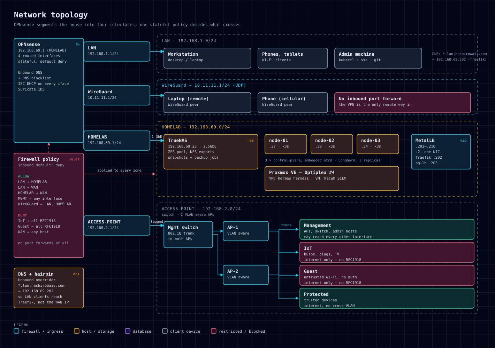

# Network

One OPNsense box routes everything. It has four interfaces, each a separate
/24, and it is the only device that moves packets between them. Nothing is
bridged across the house, so a device on one interface cannot see broadcast
traffic from another and every crossing is a decision the firewall makes.



## Interfaces

| Interface | Address | What is on it |
|---|---|---|
| LAN | 192.168.1.1/24 | Desktops, laptops, phones; the machine you run `kubectl` from |
| HOMELAB | 192.168.69.1/24 | TrueNAS at .23, the three k3s nodes at .37/.38/.34, MetalLB VIPs .202–.210 |
| ACCESS-POINT | 192.168.2.1/24 | One management switch, two VLAN-aware APs, four VLANs behind them |
| WireGuard | 10.11.11.1/24 | Laptop and phone when they are away from the house |

The HOMELAB subnet is where the services live, and it is not a client network.
Nothing that a person browses from belongs there; that is what LAN is for. The
split means a compromised laptop is one routed hop away from the NAS, and that
hop is a rule you can read.

## The wireless side

The access-point interface is the only one with a switch behind it:

```
ix2 → management switch → AP-1, AP-2 → four VLANs
```

The switch is managed and the uplink is a trunk; the APs are VLAN-aware, so each
SSID lands on its own VLAN rather than sharing the native one. The four VLANs
are:

| VLAN | Who is on it | What it may reach |
|---|---|---|
| Management | The switch, both APs, admin hosts | Any other interface — this is the one VLAN allowed to cross |
| IoT | Bulbs, plugs, the TV | The internet. Nothing else |
| Guest | Visitors' phones and laptops | The internet. Nothing else |
| Protected | Trusted devices | The internet. No other interface |

Only Management is privileged. Protected holds the devices you would not put
on Guest, but it is still a client segment: it cannot route to the NAS or the
cluster. That keeps the number of ways into the lab at one.

The important part is that the enforcement lives on the firewall, not on the
APs. The APs tag traffic and the firewall decides; changing a rule changes it
for every access point at once, and a factory-reset AP cannot accidentally
start bridging IoT into the lab.

"IoT and Guest are blocked from all RFC1918" is literal: 192.168.0.0/16,
10.0.0.0/8 and 172.16.0.0/12 are unreachable from those two VLANs, in every
direction, including to each other. They get DHCP and DNS from the firewall and
a route to the internet. That is the whole policy.

Guest is treated as unprotected on purpose. The label means "a device I do not
manage", not "a visitor I authenticated", so the rules are written for the worst
case: whatever is on that VLAN gets the internet and nothing else.

## Addressing and DHCP

ISC DHCP runs on every interface, one scope per interface. The infrastructure
addresses are not leased at all:

- TrueNAS 192.168.69.23
- node-01 192.168.69.37, node-02 .38, node-03 .34
- MetalLB pool 192.168.69.202–210, of which .202 is Traefik and .203 is the
  Postgres LoadBalancer

Those addresses appear in manifests, in the cluster's kubeconfig and in the
notes here, so they are set by hand and never leased. A DHCP reservation would
also work; a fixed address is one less moving part on a machine that has to come
back after a power cut.

## DNS

Unbound on the firewall is the resolver for every interface, with a blocklist
applied at the resolver rather than at the browser. Internal names come from one
host override:

```
*.lan.hashirowais.com  →  192.168.69.202   (Traefik's LoadBalancer VIP)
```

That override is what makes `https://daymark.lan.hashirowais.com` work from a
LAN machine. Without it the name would resolve to the public Cloudflare record,
and a client inside the house would try to reach its own firewall from the
outside — which only works if the router hairpins. Pointing the name straight at
the VIP skips the question.

The public Cloudflare records still exist, and they matter: certificate
issuance uses a DNS-01 challenge, which proves control of the zone by writing a
TXT record. See [security.md](security.md#certificates).

## WireGuard

WireGuard listens on one UDP port (51820, the default) and hands peers
addresses in 10.11.11.0/24. Peers are
allowed into LAN and HOMELAB, so a laptop abroad can reach the same
`daymark.lan.hashirowais.com`, `kubectl` and `psql` endpoints it reaches at
home, without any of those being exposed.

This is the only inbound hole in the firewall. Everything else inbound is
dropped, and there are no port forwards — see below.

## Firewall rules

The policy is deny-by-default on input and explicit on each crossing:

- **WAN → anywhere**: deny. No port forwards, no UPnP, no DMZ host.
- **LAN → HOMELAB**: allow. This is how you administer the cluster and how
  `psql` reaches `192.168.69.203`.
- **LAN → WAN**: allow.
- **HOMELAB → WAN**: allow, because nodes pull images and cert-manager talks to
  Let's Encrypt and Cloudflare.
- **ACCESS-POINT, Management VLAN → any interface**: allow. It exists to
  administer the network gear.
- **ACCESS-POINT, IoT and Guest → any RFC1918**: deny, both directions.
- **ACCESS-POINT, Protected → any other interface**: deny. It is trusted
  relative to Guest, not privileged relative to the lab.
- **WireGuard → LAN and HOMELAB**: allow.
- **WAN → any host**: deny, with stateful return traffic for outbound
  connections.

Rules are stateful, so return traffic for an allowed outbound connection is not
a separate rule. The order above is the order they are evaluated in: the denies
for IoT and Guest sit above any general access-point allowance, so a later rule
cannot accidentally re-open them.

## What is deliberately not reachable

- **No inbound port forwards at all.** If a service needs to be reached from
  outside, it is reached over WireGuard or not at all.
- **No public dashboards.** Grafana, ArgoCD and the Kubernetes API are all
  inside; you get to them from LAN, or over the VPN.
- **No management plane on the wireless client VLANs.** The APs' own admin
  interfaces are on the Management VLAN, which is the only one that can cross
  interfaces.

The consequence is that "is it exposed?" has a short answer: only if it is on
LAN, HOMELAB, the Management VLAN, or the VPN.

## Troubleshooting order

When a name does not resolve or a service is unreachable from a laptop, the
order that usually finds it fastest:

1. `dig +short daymark.lan.hashirowais.com` — should be 192.168.69.202. If it is
   a public address, the Unbound override is missing or the client is using
   another resolver.
2. `curl -sv https://192.168.69.202 -H 'Host: daymark.lan.hashirowais.com'` —
   if this works and the name does not, it is DNS, not routing.
3. `kubectl -n daymark get ingress,svc,endpoints` — an empty endpoint list means
   the pods are not ready, not that the network is broken.
