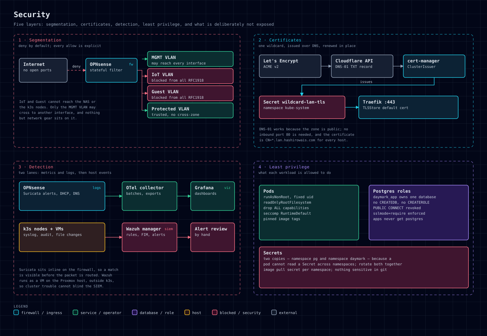

# Security

The threat model is ordinary, not exotic: a guest's laptop, an IoT device
running firmware nobody has patched since 2019, and my own mistakes. The design
answer is to make each of those a local problem — a compromised bulb should not
be able to reach the NAS, and a mistake in one namespace should not be able to
read another one's database.

## Segmentation

The firewall has four interfaces and the wireless side has four VLANs behind
one of them; both are in [network.md](network.md). What matters here is the
shape of the result:

- **One choke point.** Every crossing between zones is routed by OPNsense. There
  is no switch doing inter-VLAN routing on the side, so there is no second place
  to keep rules correct.
- **IoT and Guest are blocked from all RFC1918 addresses**, in both directions.
  They still get DHCP and DNS from the firewall and a route to the internet,
  because a device that cannot resolve anything is a device that will be
  plugged in somewhere worse.
- **Only the Management VLAN may cross interfaces.** It holds the switch, the
  APs and the admin hosts. That is a deliberate concentration: if you can reach
  the management VLAN you can reach everything, so it is the one VLAN with no
  client devices on it.
- **The lab is not a client network.** HOMELAB carries the NAS and the cluster;
  people browse from LAN. The rule `LAN → HOMELAB allow` is what makes admin
  work possible, and it is also the widest rule in the policy.

The trade-off is explicit: a device on LAN can reach the NAS, the Kubernetes
API, and the Postgres LoadBalancer. That is the price of a usable admin
workstation, and it is why LAN is not where untrusted devices live.

## What the firewall refuses to do

There are no port forwards and no DMZ host. Inbound from WAN is dropped except
for the WireGuard UDP port. Remote access is the VPN, which means it is
authenticated by key and lands the peer inside a zone where the normal rules
apply, rather than publishing a service and hoping its auth is good.

This has a cost worth naming: there is no way to reach anything from a browser
on a machine that cannot run WireGuard. That is accepted. A homelab does not
need a public status page badly enough to run one.

## Detection: Suricata

Suricata runs inline on the firewall and sees traffic as it is routed, so a
signature match is recorded before the packet reaches its destination. It is the
IDS for the boundaries — the interesting traffic is what crosses interfaces,
not what stays inside one.

It is not a substitute for the rules. Signatures are noisy, they miss anything
new, and encrypted traffic limits what can be inspected. The rules decide; the
IDS tells you when something is probing the decision.

Alerts and the firewall's DHCP/DNS logs are shipped to the observability stack,
where a DHCP lease is what turns an IP address in an alert into a device name.

## Detection: Wazuh

Wazuh is the SIEM, and it runs as a VM on the Proxmox host — deliberately
outside Kubernetes. The reasoning is the same as keeping a log server on
separate hardware: if the cluster is the thing that is broken, an in-cluster
SIEM goes down with it. Wazuh collects host and endpoint events (syslog, audit,
file integrity) from the nodes and the VMs and applies rules to them.

The split between the two tools is by data, not by preference: Suricata answers
"what crossed the firewall", Wazuh answers "what changed on this machine". The
overlap — a firewall event about a host — is where the two together are more
useful than either alone.

## Certificates

TLS is issued once, as a wildcard, and served by Traefik for every host:

1. cert-manager runs a `ClusterIssuer` pointed at Let's Encrypt's ACME v2
   directory.
2. The issuer solves **DNS-01** through the Cloudflare API, using an API token
   stored in a Secret. The challenge is a TXT record in the public zone.
3. A `Certificate` object asks for `*.lan.hashirowais.com` and
   `lan.hashirowais.com`; the result lands in the Secret `wildcard-lan-tls` in
   `kube-system`.
4. Traefik's `TLSStore` holds that Secret as the default certificate, so an
   Ingress with a `tls:` block and no `secretName` is served the wildcard.

DNS-01 rather than HTTP-01 is the whole point: issuing a certificate requires no
inbound port, so the firewall's "no forwards" rule survives renewals. The
certificate is renewable while the house is closed to the internet.

Two consequences to know:

- **The names are public even though the services are not.** `daymark.lan.
  hashirowais.com` exists in Cloudflare's zone. Anyone can resolve it; only
  machines that can route to 192.168.69.0/24 can connect. This leaks the naming
  scheme, not the services.
- **One certificate covers every host.** Adding an app means adding an Ingress,
  not a certificate. Rotating the wildcard is a single object.

## Workload hardening

The Daymark deployments are the reference for what a pod looks like here:

| Setting | Value | Why |
|---|---|---|
| `runAsNonRoot` | true, uid 10001 (api) / 101 (web) | Removes the easiest escalation path: there is no root to become |
| `readOnlyRootFilesystem` | true (api) | Nothing to write means nothing to persist |
| `allowPrivilegeEscalation` | false | Blocks setuid inside the container |
| `capabilities.drop` | `ALL` | The API binds :8080 and opens a socket; it needs none |
| `seccompProfile` | `RuntimeDefault` | The runtime's default syscall filter, at no cost |
| `resources` | requests and limits on CPU/memory | Keeps one pod from starving a node |
| probes | `/api/health`, `/healthz` | Readiness gates traffic; liveness restarts a stuck process |
| image tags | pinned per release | `:latest` makes a rollback impossible |

The web container needs one writable path for nginx's pid and temp files, so it
gets an `emptyDir` at `/tmp` rather than a writable root. That is the pattern:
add the smallest writable thing that works, not a writable filesystem.

## Database permissions

The application role is not the database admin, and the difference is
deliberate:

- `daymark_app` can log in and owns exactly one database, `daymark`.
- It has no `CREATEDB` and no `CREATEROLE`, so a SQL injection cannot make
  itself a new role.
- Default `CONNECT` on `daymark` was revoked from `PUBLIC` and granted to
  `daymark_app`, so other roles in the cluster cannot even connect to it.
- `sslmode=require` is enforced; the connection string says so and the cluster
  refuses unencrypted sessions.
- Applications never receive `postgres` or `pg-superuser`. The superuser
  password lives in one Secret and is used from an admin shell.

One awkward consequence of CloudNativePG's design: the `DatabaseRole`, the
`Database` and the password Secret must all live in the namespace of the
`Cluster` (`pg`), while the pod that uses them lives in `daymark` and cannot
read a Secret across namespaces. So the credentials exist twice — once in `pg`
for the operator, once in `daymark` for the pod. Rotating the password means
editing both. That is a real hazard, and it is written down in
[apps.md](apps.md#postgres) rather than hidden.

## Backups

Seven days of copies, in a different system from the one being backed up: etcd
snapshots and tarred volumes, pushed to an S3 target. The retention window is
short on purpose — a backup you never restore from is a liability, and seven
days is long enough to notice a deletion, short enough that the copies stay
small.

The gap worth stating plainly: Postgres has no WAL archiving and no standby. The
newest data you can recover is whatever the last volume tarball contains. If
losing up to a day of a task journal is unacceptable, WAL archiving is the thing
to add, not more replicas.

## What is not covered

Honest list, because a security page that claims completeness is worse than one
that does not:

- **No MFA in front of the internal dashboards.** Grafana and ArgoCD are
  protected by the network boundary; whatever auth they run is their own
  default, not something this repo configures.
- **No secret management beyond Kubernetes Secrets.** They are base64 in etcd
  unless etcd encryption at rest is switched on; that setting is not managed
  from git, so check it rather than assume it.
- **No image scanning gate.** Images are built by GitHub Actions and tagged; a
  vulnerable base image rolls out like any other.
- **No scheduled key rotation**, for WireGuard peers or for the Cloudflare API
  token.
- **The firewall is the single point of failure for segmentation.** Every rule
  lives on one box, so it is also one box to get wrong, and a failure that
  passes traffic turns the zones back into one network.
